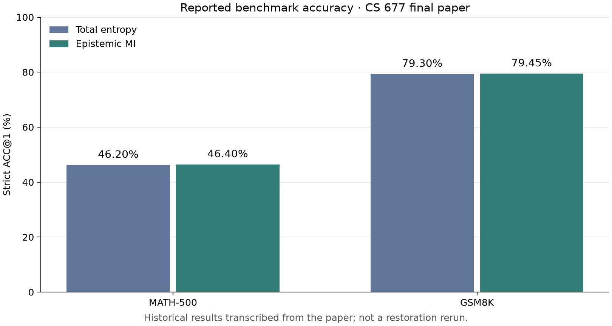
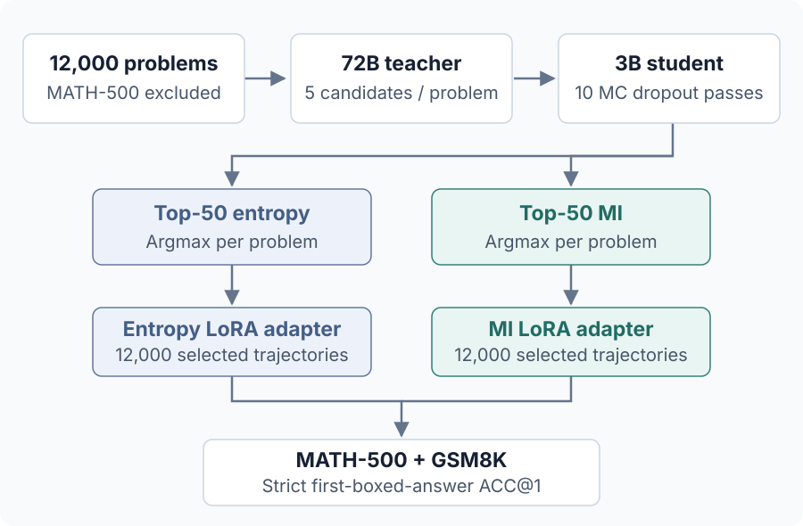

<div align="center">

# Bayesian Trajectory Selection

**Can epistemic uncertainty select better reasoning data for a small language model?**

MC dropout · Mutual information · LoRA distillation · Mathematical reasoning

[](https://github.com/jimmy19981226/bayesian-trajectory-selection/actions/workflows/tests.yml)
[](pyproject.toml)

[Results](#reported-results) · [Quick start](#quick-start) · [Method](#how-it-works) · [Paper](sources/final-paper.pdf) · [Reproduction guide](docs/REPRODUCING.md)

**James Chen · CS 677 Final Project**

</div>

This research project compares **total predictive entropy** with **epistemic mutual information (MI)** as selection rules for teacher-generated math solutions. A Qwen2.5-72B-Instruct teacher proposes five trajectories per problem; a Qwen2.5-3B student scores them with Monte Carlo dropout, then learns from each selected dataset through a separate LoRA adapter.

The repository includes an offline numerical demo, a modular model pipeline, archived research sources, and tests that exercise generation, uncertainty scoring, fine-tuning, and evaluation on a tiny local Qwen model.

> **Evidence status:** The paper, slides, and partial notebook are preserved. The Python pipeline is a documented reconstruction. Benchmark scores below come from the original paper and have **not been independently reproduced**; the original trajectories, trained adapters, and prediction logs were not recovered. [Recovery record →](docs/RECOVERY.md)

## Reported results

**Different data, small accuracy changes.** MI selected a different trajectory for **8,105 of 12,000 problems (67.54%)**, while the reported gains amounted to one additional correct answer on MATH-500 and two on GSM8K.

| Benchmark | Total entropy | Epistemic MI | Change |
| --- | ---: | ---: | ---: |
| MATH-500 | 46.20% · 231/500 | 46.40% · 232/500 | +0.20 pp |
| GSM8K | 79.30% · 1046/1319 | 79.45% · 1048/1319 | +0.15 pp |



Source: [final paper](sources/final-paper.pdf), Table 1, page 3. The metric is strict first-boxed-answer ACC@1; `pp` means percentage points. These differences do not establish statistically reliable superiority. Gains also vary by subject and difficulty.

[Full results and breakdowns →](docs/RESULTS.md) · [JSON and CSV tables →](results/reported/)

## Quick start

Run the synthetic demo on a laptop with **Python 3.11+**. It needs NumPy and downloads no model or dataset.

```bash
git clone https://github.com/jimmy19981226/bayesian-trajectory-selection.git
cd bayesian-trajectory-selection
python3 -m venv .venv
source .venv/bin/activate
python -m pip install -e '.[dev]'
cs677 demo --output runs/demo
pytest tests/test_core.py tests/test_cli.py -q
```

On Windows, activate the environment with `.venv\Scripts\Activate.ps1` in PowerShell.

The demo constructs two candidates with different uncertainty patterns. Entropy and MI choose different winners; `runs/demo/summary.json` records the disagreement and labels it **synthetic**. Use a new output directory when rerunning. This demonstrates the selection logic, not benchmark accuracy.

To exercise the complete software pipeline on small offline fixtures:

```bash
python -m pip install -e '.[ml,dev]'
HF_HUB_OFFLINE=1 python -m pytest -q
```

These tests initialize a tiny random Qwen model, train and reload LoRA adapters, and evaluate against synthetic data. For pretrained model generation and the full study, follow the [reproduction guide](docs/REPRODUCING.md#full-experiment-commands). The default 72B teacher and full training workload require suitable accelerator resources; the full experiment has not been rerun here.

## How it works



The distinction is **uncertainty within predictions versus disagreement across predictions**. If every dropout pass produces the same uncertain distribution, entropy can be high while MI is zero. If passes confidently disagree, MI is high. The implementation computes MI per token, averages its top 50 values, and selects the highest-scoring trajectory per problem.

MI is a model-dependent proxy: enabling dropout does not establish calibrated Bayesian uncertainty. Both adapters use the same reported LoRA settings (rank 16, alpha 32, two epochs). Unrecovered details are explicitly listed as reconstruction choices in [configs/paper.json](configs/paper.json).

[Experimental method and settings →](docs/METHOD.md) · [Equations and assumptions →](docs/THEORY.md)

## Implementation highlights

| Component | Engineering detail | Code |
| --- | --- | --- |
| Uncertainty scoring | Completion-only causal alignment; CPU hidden-state storage and chunked vocabulary projection avoid retaining all pass-by-token vocabulary probabilities | [modeling.py](src/cs677/modeling.py) |
| MC dropout | Verifies stochastic behavior before scoring and restores model modes afterward | [modeling.py](src/cs677/modeling.py) |
| Data selection | Complete candidate groups, finite scores, deterministic tie-breaking, and disagreement reporting | [selection.py](src/cs677/selection.py) |
| LoRA training | Prompt/padding loss masks preserve real EOS labels; precision follows the selected device | [pipeline.py](src/cs677/pipeline.py) |
| Evaluation | Nested LaTeX box parsing, strict grading, raw responses, subject/difficulty summaries | [evaluation.py](src/cs677/evaluation.py) |
| Reproducibility | Overlap checks, input hashes, run arguments, package versions, and model revision records | [reproduction guide](docs/REPRODUCING.md) |

The offline core uses NumPy; model operations use PyTorch, Transformers, Datasets, and PEFT. Optional CUDA NF4 quantization uses bitsandbytes. The CLI exposes `prepare`, `generate`, `score`, `select`, `train`, `evaluate`, and `demo`; run `cs677 COMMAND --help` for options.

## Project guide

| Start here | What it contains |
| --- | --- |
| [Method](docs/METHOD.md) / [Theory](docs/THEORY.md) | Experimental protocol, hyperparameters, derivations, and references |
| [Results](docs/RESULTS.md) | Complete historical tables and interpretation |
| [Reproducing](docs/REPRODUCING.md) | Commands, data schemas, memory considerations, and audit artifacts |
| [Validation](docs/VALIDATION.md) | Checks performed and the limits of that evidence |
| [Recovery](docs/RECOVERY.md) | Original versus reconstructed components and missing artifacts |
| [Sources](sources/) | Original paper, presentation, notebook, and checksums |
| [Tests](tests/) | Numerical core, CLI validation, tiny-model behavior, and pipeline integration |

## Limitations and next steps

The reported differences are small, vary across MATH-500 categories, and come without recovered per-example predictions or multiple training seeds. Strict string matching also penalizes mathematically equivalent formatting. A stronger follow-up would retain paired predictions, repeat training across seeds, compare random selection and deterministic entropy, and ablate dropout rate and pass count.

The notebook's earlier chi-squared selection proposal is preserved as an **optional illustrative function**. The final paper uses per-problem argmax; the optional rule has no reported benchmark results and is not used by the reproduction commands.

The Bayesian motivation follows [Gal & Ghahramani (2016)](https://proceedings.mlr.press/v48/gal16.html). Full theoretical and implementation references are in [the method notes](docs/METHOD.md#references). Model and dataset licenses are separate; weights and downloaded datasets are not distributed here.
